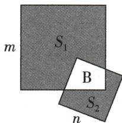

<!-- question-source:start -->
3[2025 江西抚州期中, 中]为落实劳动素质教育, 推动学生劳动实践的有效进行, 某学校在校园开辟了劳动实践基地, 如图是从实践基地中抽象出来的几何模型, 两块边长分别为 $m, n (m > n)$ 的正方形的重叠部分 B 为池塘, $S_{1}, S_{2}$ 分别表示八年级和九年级的实践基地 (阴影部分) 的面积. 若 $m + n = 8$ , $mn = 15$ , 则 $S_{1} - S_{2} = \_$ .

<!-- question-source:end -->

![[Q00104467A1]]
