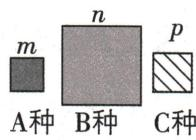
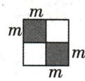
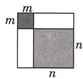
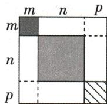

<!-- question-source:start -->
4 新考法[2025 浙江杭州期中, 中]如图(1), A、B、C三种正方形的边长分别为m,n,p,且 $m+p<n$ .

(1)用两个 A 种正方形组合成图(2)的图形,外边框可以围成一个大正方形,则这个大正方形的面积为\_\_\_\_.(用含 m 的代数式表示)

(2) 将一个 A 种和一个 B 种正方形组合成图 (3) 的图形, 外边框可以围成一个大正方形, 用两种不同的方法表示这个大正方形的面积为 \_\_\_\_ 或 \_\_\_\_, 从而可以得到一个乘法公式: \_\_\_\_.

(3) 将一个 A 种、一个 B 种和一个 C 种正方形组合成图(4)的图形, 外边框可以围成一个大正方形, 类比(2)的思路进行思考, 直接写出所得到的等式: \_\_\_\_.

(4)用 A、B、C 三种正方形画出恰当的图形,说明 $(n-m-p)^{2}<n^{2}-m^{2}-p^{2}$ .

图(1)

图(2)

图(3)

图(4)
<!-- question-source:end -->

![[Q00104468A1]]
