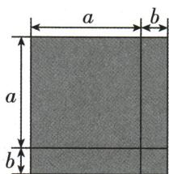
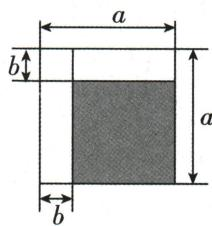
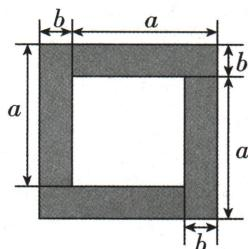
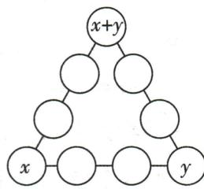

<!-- question-source:start -->
5 核心素养运算能力 [较难] (1) 从图(1)\~(3)中任意选择一个,通过计算图中阴影部分的面积,可得到关于 $a, b$ 的等量关系是

图(1)

图(2)

图(3)

(2)尝试解决：

①已知 $m+n=2, m^{2}+n^{2}=7$ ，则 mn= \_\_\_\_.

②已知 $2a+b=3, ab=1$ ，求 $(2a-b)^{2}$ 的值.
③已知 $(4-x)(5-x)=6$ ，求 $(4-x)^{2}+(5-x)^{2}$ 的值.

(3) 填数游戏: 如图(4), 把数字 1\~9 填入构成三角形形状的 9 个圆圈中, 使得各边上的四个数字的和都等于 21, 将每边四个数字的平方和分别记为 A, B, C, 已知 $A + B + C = 411$ . 如果将位于这个三角形顶点处的三个圆圈填入的数字分别表示为 x, y, $x + y$ , 求 xy 的值.

图(4)

<!-- question-source:end -->

![[Q00104469A1]]
