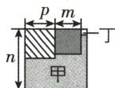

> [!success]- 必刷题
>
> > [!success] **【答案】** A
>
> > [!note]- **【解析】**
> > 【解】(1)由题意得大正方形的边长为2m，则这个大正方形的面积为 $(2m)^{2}=4m^{2}$ ，故答案为 $4m^{2}$ .
> > (2) 方法一: 这个大正方形的边长为 $m+n$ ，则这个大正方形的面积为 $(m+n)^{2}$ ;
> > 方法二: 因为这个大正方形的面积等于两个小正方形的面积与两个小长方形的面积之和, 所以这个大正方形的面积为 $m^{2}+n^{2}+2mn$ , 从而可以得到一个乘法公式: $(m+n)^{2}=m^{2}+n^{2}+2mn$ , 故答案为 $(m+n)^{2}, m^{2}+n^{2}+2mn$ (前两个空的答案可以互换), $(m+n)^{2}=m^{2}+n^{2}+2mn$ .
> >
> > (3)方法一:这个大正方形的边长为 $m+n+p$ ，则这个大正方形的面积为 $(m+n+p)^{2}$ ；方法二:因为这个大正方形的面积等于3个小正方形的面积与6个小长方形的面积之和,所以这个大正方形的面积为 $m^{2}+n^{2}+p^{2}+2mn+2mp+2np$ ，则所得到的等式为 $(m+n+p)^{2}=m^{2}+n^{2}+p^{2}+2mn+2mp+2np$ 。故答案为 $(m+n+p)^{2}=m^{2}+n^{2}+p^{2}+2mn+2mp+2np$ 。
> > (4)如图(图形不唯一)，图形丁是边长为n-m-p的正方形，则图形丁的面积为 $(n-m-p)^{2}$ 。因为图形甲的面积为 $n^{2}-m^{2}-p^{2}$ ，所以 $(n-m-p)^{2}<n^{2}-m^{2}-p^{2}$ 。
> >
> > ## 关键点拨
> >
> > (3) 类比 (2) 的思路, 用两种方法分别表示出大正方形的面积, 即可得出结果.
> >
> > 
> >
> > ## 刷素养·
> >
> > 关键点按
> > m 与 $\frac{1}{m}$ 互为倒数, 即乘积为 1, 所以完全平方公式中 “2ab” 这一项就等于 2.
