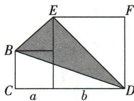

<!-- question-source:start -->
2[2024吉林长春期中,中]如图所示,边长分别为a和b的两个正方形拼接在一起,则图中阴影部分的面积为
A. $\frac{1}{2}b^{2}$ B. $\frac{1}{2}a^{2}$ C. $\frac{1}{2}(a+b)$ D. $(a+b)^{2}$

<!-- question-source:end -->

![[Q00104399A1]]
