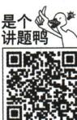

<!-- question-source:start -->
4[较难]阅读下列文字,并解决问题.
已知 $x^{2}y=3$ , 求 $2xy(x^{5}y^{2}-3x^{3}y-4x)$ 的值.
分析: 因为满足 $x^{2}y=3$ 的 x, y 的值较多, 不能逐一代入求解, 所以考虑整体代入思想, 将 $x^{2}y=3$ 整体代入.
解: $2xy(x^{5}y^{2}-3x^{3}y-4x)=2x^{6}y^{3}-6x^{4}y^{2}-8x^{2}y=2(x^{2}y)^{3}-6(x^{2}y)^{2}-8x^{2}y=2\times3^{3}-6\times3^{2}-8\times3=-24.$ 请你用上述方法解决问题: 已知 ab = 3, 求 $(2a^{3}b^{2}-3a^{2}b+4a)(-2b)$ 的值.

<!-- question-source:end -->

![[Q00104401A1]]
