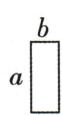
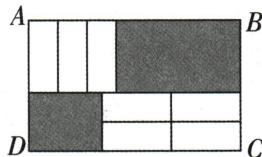

<!-- question-source:start -->
5[2025 安徽蚌埠期中,较难]学习代数式的值时,遇到这样一道题:“代数式 $ax-y+6+3x-5y-1$ 的值与x的取值无关,求a的值”.通常的解题方法是把x,y看作字母,a看作系数,合并同类项, 即原式= $(a+3)x-6y+5$ , 因为代数式的值与 x 的取值无关, 所以含 x 项的系数为 0, 所以 $a+3=0$ , 则 a=-3.

(1) 已知 $A = 2x^{2} - (1 - 3n)x, B = -x^{2} + nx - 1$ ，且 $3A + 6B$ 的值与 x 的取值无关，求 n 的值.

(2)有7张如图(1)的小长方形,长为a,宽为b,按照如图(2)的方式不重叠地放在大长方形ABCD内,大长方形中未被覆盖的部分用阴影表示,设右上角的阴影部分的面积为 $S_{1}$ ,左下角的阴影部分的面积为 $S_{2}$ ,设AB=x,当AB的长变化时, $3S_{1}-4S_{2}$ 的值始终保持不变,请求出 $\frac{a}{b}$ 的值.

图(1)

图(2)
<!-- question-source:end -->

![[Q00104402A1]]
