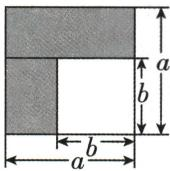
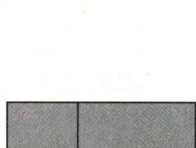

<!-- question-source:start -->
7[2024 山东威海期中]乘法公式的探究及应用:
(1)如图(1),若将阴影部分裁剪下来,重新拼成一个长方形,如图(2),通过比较图(1)、图(2)阴影部分的面积,可以得到整式乘法公式:\_\_\_\_.
(2)运用你所得到的乘法公式,计算或化简下列各式:
① $102\times98$ ;② $(2m+n-3)(2m-n-3)$ .

图(1)

图(2)
<!-- question-source:end -->

![[Q00104775A1]]
