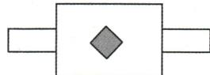

<!-- question-source:start -->
7 新考向传统文化 [2024 陕西西安校级质检] 榫卯是中国古代建筑、家具及其他器械的主要结构方式, 在两个构件上采用凹凸部位相结合的方式来连接. 木工在做某物件时, 利用榫卯结构连接了一个零部件, 平面图由 3 个长方形构成, 其中较大长方形的长为 $2a + 3b$ , 宽为 $a + 2b$ ; 另外两个长方形的长为 $a + b$ , 宽为 $a - b$ , 木工计划在中间凿一个边长为 $a - b$ 的正方形 (阴影部分), 如图所示.

(1) 求剩余部分的面积.

(2) 当 a=5, b=2 时, 剩余部分的面积是多少?

<!-- question-source:end -->

![[Q00104410A1]]
