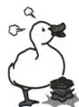

<!-- question-source:start -->
9[2025 辽宁盘锦校级质检]数学课上,在计算 $(x+a)(x+b)$ 时,琪琪把b看成6,得到的结果是 $x^{2}+8x+12$ ,莹莹把a看成7,得到的结果是 $x^{2}+12x+35$ .

(1) 请求 a, b 的值.

(2) 请求出正确的结果.

不做题
我就跺脚鸭
<!-- question-source:end -->

![[Q00104412A1]]
