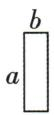
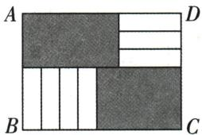

<!-- question-source:start -->
2[2025 福建三明期中, 中] 如图(2), 长方形 ABCD 内, 未被小长方形 (均为图(1)的小长方形) 覆盖的部分用阴影表示, 设左上角与右下角的阴影部分的面积的差为 S, 当 BC 的长度变化时, S 始终不变, 则 a, b 应满足 ( )

图(1) 图(2)
A. a=b B. a=3b C. a=2b D. a=4b
<!-- question-source:end -->

![[Q00104414A1]]
