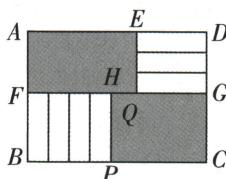

> [!success]- 必刷题
>
> > [!success] **【答案】** B
>
> > [!note]- **【解析】**
> > 如图所示, 左上角阴影部分的长为 AE, 宽为 AF = 3b, 右下角阴影部分的长为 PC, 宽
> >
> > 
> >
> > 为 $CG = a$ . $\because AE = AD - ED = BC - ED = BC - a$ , $PC = BC - BP = BC - 4b$ , $\therefore S = AE \cdot AF - PC \cdot CG = (BC - a) \cdot 3b - (BC - 4b) \cdot a = (3b - a)BC + ab$ . $\because$ 当 $BC$ 的长度变化时, $S$ 始终不变, $\therefore 3b - a = 0$ , 即 $a = 3b$ .
> >
> > 故选 **B**.
