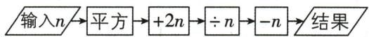

<!-- question-source:start -->
2[2025 福建泉州校级质检, 中]如图, 对于任意正整数 n, 按流程图的计算方式, 得到的结果
( )
输入n→平方→+2n→÷n→-n→结果
A. 随 n 的变化而变化 B. 不变, 总是 0
C. 不变, 总是 1 D. 不变, 总是 2

<!-- question-source:end -->

![[Q00104437A1]]
