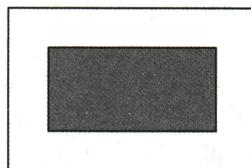

<!-- question-source:start -->
5[2025 贵州毕节期末, 中]如图, 某新建高铁站前有一块长 $(4a+3b)$ m、宽 $(3a+4b)$ m 的长方形空地, 现计划在空地中间建一个长方形喷泉池（图中阴影部分）, 喷泉池四周是宽度均为 b m 的人行通道.

(1) 求喷泉池的占地面积 (用含 $a, b$ 的代数式表示).

(2)喷泉池建成后,需给人行通道铺上地砖以方便旅客通行,若每块地砖的面积是 $\frac{1}{13}b\ m^{2}$ ,则刚好铺满(既不重叠又无缝隙)时,需要多少块这样的地砖?

<!-- question-source:end -->

![[Q00104440A1]]
