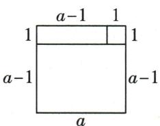
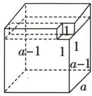

<!-- question-source:start -->
7[2025黑龙江哈尔滨期中]我们在学习许多代数公式时,可以用几何图形来推理验证.观察图(1), $a^{2}-1=a(a-1)+(a-1)=(a-1)(a+1)$ .接下来,观察图(2),通过类比思考,因式分解: $a^{3}-1=$ \_\_\_\_.

图(1)

图(2)
<!-- question-source:end -->

![[Q00104874A1]]
