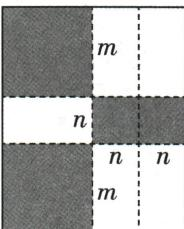

<!-- question-source:start -->
10[2025 河北秦皇岛期末]如图, 将一张长方形纸板按图中虚线裁剪成九块, 其中有两块是边长都为 $m \mathrm{~cm}$ 的大正方形, 两块是边长都为 $n \mathrm{~cm}$ 的小正方形, 五块是长为 $m \mathrm{~cm}$ , 宽为 $n \mathrm{~cm}$ 的小长方形 $(m > n)$ .

(1) 观察图形, 可以发现代数式 $2 m^{2} + 5 m n + 2 n^{2}$ 可以因式分解为 \_\_\_\_. (2) 若每块小长方形的面积为 $10 \mathrm{~cm}^{2}$ , 两块大正方形和两块小正方形的面积和为 $58 \mathrm{~cm}^{2}$ . ①试求 $m + n$ 的值.

②图中所有裁剪线(虚线部分)长之和为\_\_\_\_cm.(直接写出结果)

沉迷刷题
无法自拔
<!-- question-source:end -->

![[Q00104877A1]]
