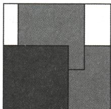

<!-- question-source:start -->
8 如图, 在边长为 $a \mathrm{~cm}$ 的大正方形内放入三个边长都为 $b \mathrm{~cm}(a > b)$ 的小正方形纸片, 这三张纸片没有盖住的面积是 $4 \mathrm{~cm}^{2}$ , 则 $a^{2} - 2ab + b^{2}$ 的值为 \_\_\_\_.

<!-- question-source:end -->

![[Q00104835A1]]
