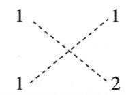

<!-- question-source:start -->
6[2025 浙江绍兴期中, 中]【阅读理解】如何将多项式 $x^{2}+(p+q)x+pq$ 分解因式呢? 我们知道 $(x+p)(x+q)=x^{2}+(p+q)x+pq$ , 所以根据因式分解与整式乘法是互逆变形, 可得 $x^{2}+(p+q)x+pq=(x+p)(x+q)$ . 例如: 因为 $(x+1)(x+2)=x^{2}+3x+2$ , 所以 $x^{2}+3x+2=(x+1)(x+2)$ . 上述过程可以用十字相乘的形式形象地表示: 先分解二次项系数, 分别写在十字交叉线的左上角和左下角; 再分解常数项, 分别写在十字交叉线的右上角和右下角; 然后交叉相乘, 求代数和, 使其等于一次项的系数, 如图所示.

<!-- question-source:end -->

![[Q00104844A1]]
