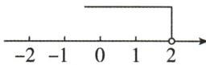

> [!success]- 必刷题
>
> > [!success] **【答案】** C
>
> > [!note]- **【解析】**
> > ∵ 分式 $\frac{1}{x-2}$ 表示的数是负数，
> > ∴ $\frac{1}{x-2}<0, \therefore x<2, \therefore x$ 的取值范围在数轴上表示如下：
> >
> > 
> >
> > 故选 C.
> >
> > 分式无意义，
> > 分母为零；分
> > 式值为零，分
> > 子为零而分母
> > 不为零.
> >
> > ## 关键点拨
