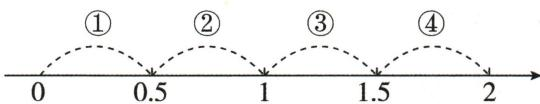

<!-- question-source:start -->
6[2025 黑龙江哈尔滨质检]如图, 若 x 为正整数, 则表示 $\frac{x^{2}+3x}{x^{3}-x}\cdot\frac{x-1}{3+x}-(x^{-1}-1)\div(x^{-1}+1)$ 的值的点落在 ( )

A. 段①
B. 段②
C. 段③
D. 段④
<!-- question-source:end -->

![[Q00105035A1]]
