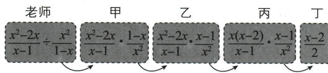

<!-- question-source:start -->
7 老师设计了接力游戏,用合作的方式完成分式化简. 规则是每人只能看到前一人给的式子,并进行一步计算,再将结果传递给下一人,最后完成化简. 过程如图所示:

接力中,自己负责的一步出现错误的是( )
A. 只有乙 B. 甲和丁 C. 乙和丙 D. 乙和丁
<!-- question-source:end -->

![[Q00104916A1]]
