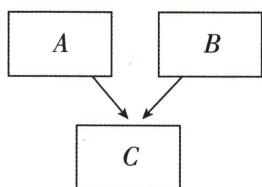
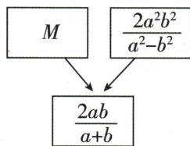

<!-- question-source:start -->
8[2025 河北唐山期中]如图(1), 规定 $A \cdot B = C$ ,
若按此规定,则图(2)中M处的代数式是()

图(1)
图(2)

A. $a - b$ B. $ab$ C. $\frac{a - b}{ab}$ D. $\frac{4a^3b^3}{a^2 - b^2}$
<!-- question-source:end -->

![[Q00104917A1]]
