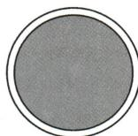
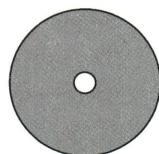

<!-- question-source:start -->
9[2024 湖北荆州期中]如图(1)为“惠民1号”玉米试验田,是半径为R米的圆去掉宽为1米的出水沟(空白部分)剩下的部分;如图(2)为“惠民2号”玉米试验田,是半径为R米的圆中间去掉半径为1米的圆(空白部分)剩下的部分,两块玉米试验田的玉米都收了450千克.
(1)哪块玉米试验田的玉米的单位面积产量高?
(2)两块玉米试验田的玉米单位面积产量高的是单位面积产量低的多少倍?

图(1)

图(2)
<!-- question-source:end -->

![[Q00104918A1]]
