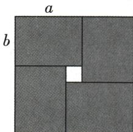

<!-- question-source:start -->
3[2025 山东临沂期末, 中]如图, 将四张长、宽分别为 $a, b (a > b > 0)$ 的长方形硬纸片拼成一个中间“带孔”的大正方形, 已知拼成的大正方形的面积为 49 , 中间小正方形的面积为 1 , 则 $(a^4 - b^4) \div \frac{a^2 + b^2}{ab} \div (6a - 6b)$ 的值为 \_\_\_\_.

<!-- question-source:end -->

![[Q00104921A1]]
