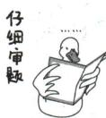

<!-- question-source:start -->
8 核心素养运算能力 [难] 阅读下列解题过程, 然后解题:
题目: 已知 $\frac{x}{a-b} = \frac{y}{b-c} = \frac{z}{c-a} (a, b, c$ 互不相等), 求 $x + y + z$ 的值.
解: 设 $\frac{x}{a-b} = \frac{y}{b-c} = \frac{z}{c-a} = k$ ，则 $x = k(a - b)$ , $y = k(b - c)$ , $z = k(c - a)$ ,
所以 $x+y+z=k(a-b+b-c+c-a)=k\cdot0=0$ ，所以 $x+y+z=0.$ 仿照上述方法解答下列问题：
已知 $\frac{y+z}{x}=\frac{z+x}{y}=\frac{x+y}{z}$ ，其中 $x+y+z\neq0$ ，求 $\frac{x+y-z}{x+y+z}$ 的值.

<!-- question-source:end -->

![[Q00104894A1]]
