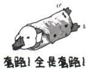

<!-- question-source:start -->
3 已知 $\frac{3 - x}{x^2 - 2x + 1} \div P = 1 + \frac{x^2 - 2x - 1}{1 - x}$ .

(1) 求 $P$ (化成最简形式);

(2) 当 $x = n$ 时, 记 $P$ 的值为 $P(n)$ . 如: 当 $x = 2$ 时, $P$ 的值为 $P(2)$ ; 当 $x = 3$ 时, $P$ 的值为 $P(3)$ ; $\cdots$ . 请写出关于 $t$ 的不等式 $\frac{t - 2}{4} - \frac{3 - t}{2} \geqslant P(2) + P(3) + P(4) + P(5) + P(6) + P(7) + P(8)$ 的解集及最小整数解.

套路! 全是套路!
<!-- question-source:end -->

![[Q00104948A1]]
