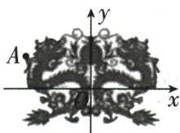

<!-- question-source:start -->
1[2024 内蒙古通辽中考]剪纸是我国民间艺术之一,如图放置的剪纸作品,它的对称轴与平面直角坐标系的坐标轴重合.则点 A(-4,2)关于对称轴对称的点的坐标为 ( )

A. $(-4, - 2)$ B. $(4, - 2)$ C. $(4,2)$ D. $(-2, - 4)$
<!-- question-source:end -->

![[Q00105046A1]]
