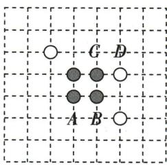

<!-- question-source:start -->
3[2024 甘肃中考]围棋起源于中国,古代称为“弈”.如图是两位同学的部分对弈图,轮到白方落子,观察棋盘,白方如果落子于点\_\_\_\_的位置,则所得的对弈图是轴对称图形.(填写

A,B,C,D 中的一处即可,A,B,C,D 位于棋盘的格点上)

\- 新考向 2 跨学科综合 -
<!-- question-source:end -->

![[Q00105048A1]]
