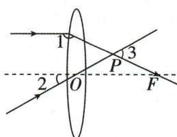

<!-- question-source:start -->
5[2023 山西中考]如图,一束平行于主光轴的光线经凸透镜折射后,其折射光线与一束经过光心 O 的光线相交于点 P, 点 F 为焦点. 若 $\angle1=155^{\circ}, \angle2=30^{\circ}$ , 则 $\angle3$ 的度数为 ( )

A. $45^{\circ}$ B. $50^{\circ}$ C. $55^{\circ}$ D. $60^{\circ}$
<!-- question-source:end -->

![[Q00105050A1]]
