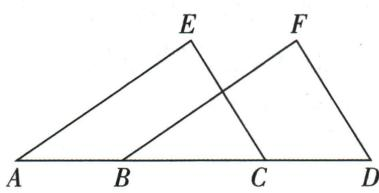

<!-- question-source:start -->
7[2024 江苏盐城中考]已知:如图,点 A,B,C,D 在同一条直线上, $AE \parallel BF$ , AE = BF. 若 \_\_\_\_, 则 AB = CD.

请从①CE//DF; ②CE=DF; ③ $\angle E=\angle F$ 这3个选项中选择一个作为条件(写序号),使结论成立,并说明理由.

<!-- question-source:end -->

![[Q00105052A1]]
