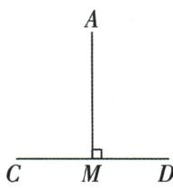

<!-- question-source:start -->
8[2023 江苏泰州中考]如图, $CD$ 是五边形 $ABCDE$ 的一边, 若 $AM$ 垂直平分 $CD$ , 垂足为 $M$ , 且 \_\_\_\_, \_\_\_\_, 则 \_\_\_\_. 给出下列信息: ① $AM$ 平分 $\angle BAE$ ; ② $AB = AE$ ; ③ $BC = DE$ . 请从中选择适当信息, 将对应的序号填到横线上方, 使之构成真命题, 补全图形, 并加以证明.

<!-- question-source:end -->

![[Q00105053A1]]
