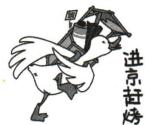
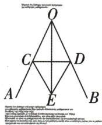
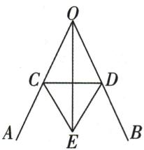
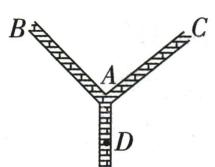
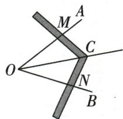
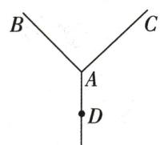

<!-- question-source:start -->
11[2024广西中考]综合与实践
在综合与实践课上,数学兴趣小组通过洗一套夏季校服,探索清洗衣物的节约用水策略.
【洗衣过程】
步骤一:将校服放进清水中,加入洗衣液,充分浸泡揉搓后拧干;
步骤二:将拧干后的校服放进清水中,充分漂洗后拧干.重复操作步骤二,直至校服上残留洗衣液浓度达到洗衣目标.
假设第一次漂洗前校服上残留洗衣液浓度为0.2%,每次拧干后校服上都残留0.5kg水.
浓度关系式: $d_{后}=\frac{0.5d_{前}}{0.5+w}$ .其中 $d_{前},d_{后}$ 分别为单次漂洗前、后校服上残留洗衣液浓度;w为单次漂洗所加清水量(单位:kg).
【洗衣目标】经过漂洗使校服上残留洗衣液浓度不高于0.01%.

【动手操作】请按要求完成下列任务：

(1) 如果只经过一次漂洗, 使校服上残留洗衣液浓度降为 $0.01\%$ , 需要多少清水?

(2) 如果把 4 kg 清水均分, 进行两次漂洗, 是否能达到洗衣目标?

(3) 比较(1)和(2)的漂洗结果,从洗衣用水策略方面,说说你的想法.

拓展实践:(3)小明将研究应用于实践.如图(4),校园的两条小路AB和AC,汇聚形成了一个岔路口A,现在学校要在两条小路之间安装一盏路灯E,使得路灯照亮两条小路(两条小路一样亮),并且路灯E到岔路口A的距离和休息椅D到岔路口A的距离相等,试问路灯应该安装在哪个位置?请用不带刻度的直尺和圆规在对应的示意图(5)中作出路灯E的位置.(保留作图痕迹,不写作法)

图(1)

图(2)

图(4)

图(3)

图(5)
<!-- question-source:end -->

![[Q00105056A1]]
