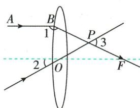

> [!success]- 必刷题
>
> > [!success] **【答案】** C
>
> > [!note]- **【解析】**
> > 如图,∵ AB∥OF,∴ ∠1+∠BFO=180°.
> > ∵ ∠1 = 155°, ∴ ∠BFO = 180° - 155° = 25°. ∵ ∠2 = 30°, ∴ ∠POF = ∠2 = 30°,
> >
> > 
> >
> > $\therefore \angle 3 = \angle POF + \angle BFO = 30^{\circ} + 25^{\circ} = 55^{\circ}$ ，
> >
> > 故选 **C**.
