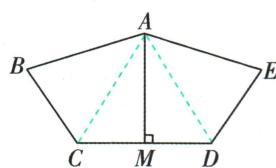

> [!success]- 必刷题
>
> > [!success] **【答案】** 详见解析
>
> > [!note]- **【解析】**
> > 【解】根据题意补全图形并连接 AC, AD, 如图所示.
> > 方法一: 依次填入②③①(或③②①).
> >
> > 
> >
> > 证明：∵ AM 垂直平分 CD，∴ CM=DM, AC=AD.
> > 在△ACM 与△ADM 中， $\left\{\begin{aligned}AM&=AM,\\ AC&=AD,\\ CM&=DM,\end{aligned}\right.$ ∴ $\triangle ACM \cong \triangle ADM(SSS)$ , ∴ $\angle CAM = \angle DAM$ .
> > 在△ABC 与△AED 中， $\left\{\begin{aligned}AB &= AE,\\ AC &= AD,\\ BC &= ED,\end{aligned}\right.$ (SSS)，∴ $\angle BAC = \angle EAD$ . 又∵ $\angle CAM = \angle DAM$ ,
> > ∴ $\angle BAC + \angle CAM = \angle EAD + \angle DAM$ ，即 $\angle BAM = \angle EAM = \frac{1}{2} \angle BAE$ ，∴ AM 平分 $\angle BAE$ .
> > 方法二: 依次填入①②③(或②①③). 证明：∵ AM 垂直平分 CD，∴ CM = DM, AC = AD. 在△ACM 与
> > △ADM 中， $\left\{\begin{aligned}AM &= AM,\\ AC &= AD,\\ CM &= DM,\end{aligned}\right.$ ∴ $\angle CAM = \angle DAM$ . ∵ AM 平分 $\angle BAE$ , ∴ $\angle BAM = \angle EAM$ . 又∵ $\angle CAM = \angle DAM$ , ∴ $\angle BAM - \angle CAM = \angle EAM - \angle DAM$ , 即 $\angle BAC = \angle EAD$ . 在△ABC 与
> > △AED 中， $\left\{\begin{aligned}AC &= AD,\\ \angle BAC &= \angle EAD,\\ AB &= AE,\end{aligned}\right.$ (SAS), ∴ BC = DE. (选择一种方法即可)
