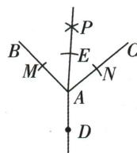

> [!success]- 必刷题
>
> > [!success] **【答案】** SSS
>
> > [!note]- **【解析】**
> > 【解】(1)∵△CDE是等边三角形，∴CE=DE.又∵OC=OD,OE=OE,∴△OCE≌△ODE(SSS),∴∠COE=∠DOE,∴OE是∠AOB的平分线，故答案为SSS.
> > (2)∵OM=ON,CM=CN,OC=OC,∴△OCM≌
> > △OCN(SSS),∴∠AOC=∠BOC,∴射线OC是
> > ∠AOB的平分线.
> >
> > (3)如图,点E即为所求的点.
> >
> > 
> >
> > 其实人跟树是一样的
> > 越是向往高处的阳光
> > 它的根就越要伸向黑暗的地底
> > 所以那些黑夜里你默默刷的每一道题
> > 都是为了更快缩短与光的距离
> >
> > 您在使用本书时若有问题需要反馈，请及时与我们联系。经核实后，您发现的问题或所提的建议确实对优化本书内容有益，我们将为您提供相应奖励。
> >
> > 
