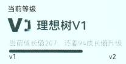
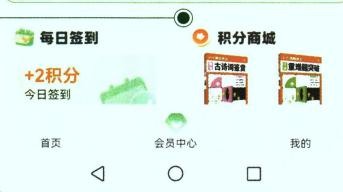
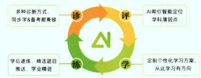

## 中考新考向备训

![[初中/课堂同步/教辅/必刷题/2026版《初中必刷题》数学 RJ  8上/99_中考新考向备训/中考新考向备训/questions/Q00105046.md]]
![[初中/课堂同步/教辅/必刷题/2026版《初中必刷题》数学 RJ  8上/99_中考新考向备训/中考新考向备训/questions/Q00105047.md]]
![[初中/课堂同步/教辅/必刷题/2026版《初中必刷题》数学 RJ  8上/99_中考新考向备训/中考新考向备训/questions/Q00105048.md]]
![[初中/课堂同步/教辅/必刷题/2026版《初中必刷题》数学 RJ  8上/99_中考新考向备训/中考新考向备训/questions/Q00105049.md]]
![[初中/课堂同步/教辅/必刷题/2026版《初中必刷题》数学 RJ  8上/99_中考新考向备训/中考新考向备训/questions/Q00105050.md]]

## - 新考向 3 开放性试题

![[初中/课堂同步/教辅/必刷题/2026版《初中必刷题》数学 RJ  8上/99_中考新考向备训/中考新考向备训/questions/Q00105051.md]]
![[初中/课堂同步/教辅/必刷题/2026版《初中必刷题》数学 RJ  8上/99_中考新考向备训/中考新考向备训/questions/Q00105052.md]]
![[初中/课堂同步/教辅/必刷题/2026版《初中必刷题》数学 RJ  8上/99_中考新考向备训/中考新考向备训/questions/Q00105053.md]]

## - 新考向 4 22 版课标新增知识点

## (1) 尺规作图 过直线外一点作平行线

![[初中/课堂同步/教辅/必刷题/2026版《初中必刷题》数学 RJ  8上/99_中考新考向备训/中考新考向备训/questions/Q00105054.md]]

## (2) 代数推理

![[初中/课堂同步/教辅/必刷题/2026版《初中必刷题》数学 RJ  8上/99_中考新考向备训/中考新考向备训/questions/Q00105055.md]]

## - 新考向 5 项目化学习 •

![[初中/课堂同步/教辅/必刷题/2026版《初中必刷题》数学 RJ  8上/99_中考新考向备训/中考新考向备训/questions/Q00105056.md]]

## - 新考向 6 探究性试题 •

![[初中/课堂同步/教辅/必刷题/2026版《初中必刷题》数学 RJ  8上/99_中考新考向备训/中考新考向备训/questions/Q00105057.md]]

# “理想树图书”专属【会员&增值】服务平台

小程序

微信扫图书背面二维码注册会员

周六抽奖

动书600+本动态教辅书同步更新

学法
全学科知识总结与学法提炼

理想
头条
活动公告 你的笔记值得炫耀！
英语 【VOA慢速】具有敏锐洞察力的“鹰眼”

错题打印图书增值
全套资源，一键畅享

图书兑换错题本
边学边攒错题本

诊评学练，一步到位，智能伴学，学业精进

AI改作文AI智能批改，专业写作帮手

## 青藤计划 {以书载梦，以行践责——青藤计划公益项目}

理想树联合中国光华科技基金会共建公益助学行动，设立100万专项基金。每一笔善款都经由国家级4A基金会专业运作，让善意在阳光下开枝散叶。

若您身边有亟需帮助的学子，请以学校为单位与我们联系，我们与您携手并肩，为每一个理想全力以赴。

邮箱地址：67book@lxzwedu.com
联系电话：400-688-9167

作文大赛 {真题作文爆改行动 全网捞显眼包！}

扫码解锁更多攻略

真题作文太难了？不存在的！

2025年6月7日—8月10日
持续收集新中考真题作文，投稿即有机会解锁SSR级奖励！

媒体号

刷题小手 点点关注

@理想树初中

@众望教育集团

活动专区

句有引力 {笔尖星光，页脚绽放
——理想树页脚语征集}

把你的感悟写成便签，塞进理想树书页的缝隙

某年某月，当陌生人的指尖翻到这里——你的句子，会轻轻叩响一颗共鸣的心

优质稿件可获得精美礼品每月7日前在理想树初中公众号公布

活动时间
即日起—2025年12月31日

▶扫码即可投稿参与活动

@理想树图书官方号

@理想树图书官方

小红书

@理想树必刷题 试题网
www.stzy.com

众望教育官网
www.lxzwedu.com

小考、中考，期中考、期末考，单元考、月考，你从各种考试中走来。

选择题、填空题、解答题；
作用力的问题、赛跑的问题、溶液的问题；
你认不认得这个字，你会写吗；
他活了多少岁，他做了几件好事、几件坏事；
函数、三角形还有一个圆，达·芬奇画画都在用的那些原理；

run还是running，加to还是for；

Oh，你天天都在刷。

我害怕你，刷题的人。
一道题，一打眼你就知道考的是哪个知识点；
一看选项，你就知道错在哪里，
你就知道那是个陷阱。
你看透了出题人，
他们的那些挖空心思、绞尽脑汁，
在你面前都是一些无法遁形的小小伎俩。
拿起试卷，你嘴角上扬，
你可知道，那是只属于赢家的笑。

我害怕你，刷题的人。
你用自己活生生地界定了学神与学霸灵魂上的差别：学霸题海里游出一身肌肉，学神题海里踏出一条大道。

你明白刷题的意义，

你知道刷题的好与坏。

你懂得分类，

你有自己的一套策略。

我害怕你，刷题的人。
人世间的种种，
甚至是生活的种种逻辑，
逃不出刷题的范围。
你去琢磨，你去钻研，
你用刷题的逻辑解决生活中遇到的问题，
你发现毫不违和，通行天下。

每天，你来到教室，
坐下来，拉开架势，
打开那本仿佛可以轻松拿下的教科书，
似乎要虽千万人吾往矣。

你明白，
你明白这是一条不得不走的路。
你明白有些东西考过即扔，
希望老死不相往来。
你明白，你都明白。

而你不言不语，不怒不哀，不逃不躲，
你打下整个世界，
天朗气清，惠风和畅。
