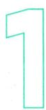

<!-- source-part:1 pages:1-50 -->

# 初中 必刷题 CHUZHONG BISHUATI 2026

主 编：杨文彬

编者：熊艳娇 李厚明 刘恩鹏 李鑫 高子军
吴成飞 吴兴文 张志东 马士荣 于胜利
杜海东 滕晓红 姜海霞 周亚勇 鲁少勇
徐边疆 仲秀杰 李艳

审订：王丽荣 张雄波 彭月 段宗武

开明出版社

数学
八年级上册 RJ

## CONTENTS 目录

## 第十三章 三角形

(正文)(答案)

13.1 三角形的概念 …… 刷基础(1)(D1)

13.2 与三角形有关的线段 …… (2)(D1)

13.2.1 三角形的边 …… 刷基础提升(2)(D1)

13.2.2 三角形的中线、角平分线、高 …… 刷基础提升(4)(D3)

重难专题1 三角形中线、高线的应用 …… 刷难关(6)(D4)

13.3 三角形的内角与外角 …… (7)(D5)

13.3.1 三角形的内角 …… (7)(D5)

课时1 三角形的内角 …… 刷基础提升(7)(D5)

课时2 直角三角形的性质与判定 …… 刷基础提升(9)(D7)

13.3.2 三角形的外角 …… 刷基础提升(11)(D9)

大招专题1 三角形中的倒角模型 …… 刷难关(13)(D10)

数学活动 …… 刷活动(16)(D13)

综合与实践 确定匀质薄板的重心位置 …… 刷实践(17)(D14)

全章综合训练 …… 刷中考章测(18)(D14)

## 重难题型微课

<table><tr><td>三角形的三边关系</td><td>P3T2</td><td>三角形的中线、高线</td><td>P5T3</td></tr><tr><td>直角三角形性质的应用</td><td>P10T3</td><td>三角形的外角的性质</td><td>P12T2</td></tr><tr><td>三角形内角和定理的应用</td><td>P18T9</td><td>三角形中的动点问题</td><td>P20T13</td></tr></table>

## 第十四章 全等三角形

14.1 全等三角形及其性质 …… 刷基础提升(21)(D18)
14.2 三角形全等的判定 …… (23)(D19)
课时1 两边及夹角证全等(SAS)
…… 刷基础提升(23)(D19)
课时2 两角及一边证全等(ASA,AAS)
…… 刷基础提升(25)(D21)
课时3 三边证全等(SSS) …… 刷基础(27)(D22)
课时4 尺规作图 …… 刷基础(28)(D23)
课时5 斜边及一直角边证全等(HL)
…… 刷基础提升(29)(D23)
大招专题2 全等三角形判定的常考模型 …… 刷难关(31)(D25)

## 新考法 新素材

研究对比全国近十年中考真题卷,发现各省市的中考会不断借鉴或探究新考法,同时会挖掘时事热点等新素材,创造新情境灵活考查知识点。中考是我们平时学习的风向标,因此我们需要关注新考法、新素材。

\- 三角形的分类
- 搭等边三角形
- 重心的确定和应用
- P1/T6
- P16/T3
- P17
- 三角形三边关系的应用
- P19/T10
- 网格中的全等三角形
- “AAS”判定定理的应用
- P24/T1
- P25/T5
- 整除问题
- P65/T4
- 因式分解的应用
- P88/T9

## 新素材

以“中国首台氟化氩光刻机”为背景考查科学记数法
▶P101/T1

\- 以“2024上合昆明马拉松”为背景考查分式方程的实际应用
- P105/T3

## 新考向

## 推荐理由

教育部发布的《关于加强初中学业水平考试命题工作的意见》中指出:弘扬中华优秀传统文化,提高探究性、开放性试题比例,积极探索跨学科命题,提高试题情境设计水平。结合《义务教育数学课程标准(2022年版)》新变化,通过分析全国百余套中考试题,发现以传统文化为背景的试题,以及探究性、开放性、综合性、跨学科试题在中考中出现得越来越频繁,故精选部分试题,让学生感受考向变化。

## 目录

大招专题3 构造全等三角形的常用方法 …… 刷难关（33）（D27）
14.3 角的平分线 …… （34）（D29）
课时1 角平分线的性质 …… 刷基础 提升（34）（D29）
课时2 角平分线的判定 …… 刷基础（36）（D31）
数学活动 …… 刷活动（37）（D32）
全章综合训练 …… 刷中考 章测（38）（D32）

## 重难题型微课

坐标系中的全等三角形 P22T4 全等三角形中的动点问题 P24T5
全等三角形中的面积问题 P26T1 全等三角形的判定与性质 P30T4
“手拉手”模型 P31T4 象限角平分线与全等三角形P40T10

## 第十五章 轴对称

15.1 图形的轴对称 …… (41) (D35)
15.1.1 轴对称及其性质 …… 刷基础 提升 (41) (D35)
15.1.2 线段的垂直平分线 …… (43) (D36)
课时 1 线段的垂直平分线的性质及判定
…… 刷基础 提升 (43) (D36)
课时 2 作线段的垂直平分线 …… 刷基础 (45) (D38)

15.2 画轴对称的图形 …… (46) (D39)
课时 1 画轴对称的图形 …… 刷基础 (46) (D39)
课时 2 轴对称与坐标变化 …… 刷基础 提升 (47) (D39)

15.3 等腰三角形 …… (49) (D41)
15.3.1 等腰三角形 …… (49) (D41)
课时 1 等腰三角形的性质 …… 刷基础 (49) (D41)
课时 2 等腰三角形的判定 …… 刷基础 提升 (50) (D42)
15.3.2 等边三角形 …… (52) (D44)
课时 1 等边三角形的性质与判定 … 刷基础 提升 (52) (D44)
课时 2 含 $30^{\circ}$ 角的直角三角形的性质 …… 刷基础 (54) (D45)

重难专题 2 等腰三角形中的分类讨论 …… 刷难关 (55) (D46)
大招专题 4 构造等腰三角形的方法 …… 刷难关 (56) (D48)
数学活动 …… 刷活动 (57) (D49)

综合与实践 最短路径问题 …… 刷实践 (58) (D49)
大招专题 5 轴对称——将军饮马 …… 刷难关 (59) (D50)

## 专题索引

## 微专题

微专题1 角平分线+平行→等腰三角形 P51
微专题2 完全平方公式变形（知2求2） P77
微专题3 已知 $x \pm \frac{1}{x}$ 的值求代数式的值 P77
微专题4 $x^{2} + (p + q)x + pq$ 型式子的因式分解 P86

## 重难专题

重难专题1 三角形中线、高线的应用 P6
类型1 三角形的中线与周长
类型2 三角形的中线与面积
类型3 等积法的应用
类型4 分类讨论思想在高线问题中的应用
重难专题2 等腰三角形中的分类讨论 P55
类型1 遇边或角需讨论
类型2 遇中线、高或垂直平分线需讨论
类型3 遇动点、动线段需讨论
类型4 构造等腰三角形时需讨论
重难专题3 分式的化简求值 P102
类型1 化简后直接代入未知数的值求值
类型2 整体代入求值
类型3 化简后利用限定条件求值
重难专题4 分式方程的含参问题 P107
类型1 分式方程有增根
类型2 分式方程有解或无解
类型3 分式方程有(非)正数解
类型4 分式方程有整数解大招专题1 三角形中的倒角模型
P13
母题学大招1 A字型
母题学大招2 飞镖型(或燕尾型)
母题学大招3 8字型
母题学大招4 双内角平分线模型
母题学大招5 内外角平分线模型
母题学大招6 双外角平分线模型
母题学大招7 双垂直模型
母题学大招8 高分线模型

大招专题2 全等三角形判定的常考
模型 P31
母题学大招9 平移模型
母题学大招10 对称模型
母题学大招11 “手拉手”模型
母题学大招12 一线三等角模型(K型)
母题学大招13 半角模型

大招专题3 构造全等三角形的常用方法 P33
母题学大招14 倍长中线法
母题学大招15 截长补短法

大招专题4 构造等腰三角形的方法
P56
母题学大招16 作平行线
母题学大招17 截长补短
母题学大招18 作延长线

大招专题5 轴对称——将军饮马
P59
母题学大招19 两定一动
母题学大招20 两动一定(有去有回)
母题学大招21 两动一定(有去无回)
母题学大招22 两定两动
母题学大招23 线段差最值问题

## 目录

全章综合训练 …… 刷中考 章测（60）（D52）

## 重难题型微课

利用轴对称求最值问题 P42T3 线段的垂直平分线的性质 P44T4
等边三角形的性质与判定 P53T3 直角三角形的性质 P54T5
等腰三角形中的分类讨论 P55T9 等边三角形的应用 P61T7
等腰三角形中的动点问题 P62T13

## 第十六章 整式的乘法

16.1 幂的运算 …… (63) (D55)
16.1.1 同底数幂的乘法 …… 刷基础 (63) (D55)
16.1.2 幂的乘方与积的乘方 …… 刷基础 提升 (64) (D55)
16.2 整式的乘法 …… (66) (D56)
课时 1 单项式与单项式相乘 …… 刷基础 (66) (D56)
课时 2 单项式与多项式相乘 …… 刷基础 提升 (67) (D57)
课时 3 多项式与多项式相乘 …… 刷基础 提升 (69) (D58)
课时 4 整式的除法 …… 刷基础 提升 (71) (D60)
16.3 乘法公式 …… (73) (D61)
16.3.1 平方差公式 …… 刷基础 提升 (73) (D61)
16.3.2 完全平方公式 …… (75) (D62)
课时 1 完全平方公式 …… 刷基础 提升 (75) (D62)
课时 2 添括号法则 …… 刷基础 (78) (D64)
数学活动 …… 刷活动 (79) (D64)
全章综合训练 …… 刷中考 章测 (80) (D64)

## 重难题型微课

化为同指数幂比较大小 P65T3 单项式乘多项式法则的应用 P68T4
根据整数解个数求参数 P70T3 添项法 P74T3
利用完全平方公式求值 P76T5

## 第十七章 因式分解

17.1 用提公因式法分解因式 …… 刷基础（83）（D66）
17.2 用公式法分解因式 …… （84）（D67）
课时1 用平方差公式分解因式 …… 刷基础（84）（D67）
课时2 用完全平方公式分解因式 … 刷基础（提升（85）（D67）
数学活动 …… 刷活动（87）（D68）

## 专题索引

## 大招专题

全章综合训练

刷中考 章测（88）(D69)

重难题型微课
完全平方公式与三角形的综合 P86T5

完全平方公式与三角形的综合 P86T5
一八章 分式
18.1 分式及其基本性质 …… (90) (D70)
18.1.1 从分数到分式 …… 刷基础 (90) (D70)
18.1.2 分式的基本性质 …… (91) (D71)
课时1 分式的基本性质 …… 刷基础 (91) (D71)
课时2 分式的约分和通分 …… 刷基础 提升 (92) (D72)
18.2 分式的乘法与除法 …… (94) (D73)
课时1 分式的乘除 …… 刷基础 提升 (94) (D73)
课时2 分式的乘除混合运算及乘方 …… 刷基础 (96) (D75)
18.3 分式的加法与减法 …… (97) (D76)
课时1 分式的加减 …… 刷基础 提升 (97) (D76)
课时2 分式的混合运算 …… 刷基础 (99) (D77)
18.4 整数指数幂 …… (100) (D78)
课时1 负整数指数幂 …… 刷基础 (100) (D78)
课时2 用科学记数法表示小于1的正数…… 刷基础 (101) (D79)
重难专题3 分式的化简求值 …… 刷难关 (102) (D79)
18.5 分式方程 …… (103) (D80)
课时1 分式方程及其解法 …… 刷基础 提升 (103) (D80)
课时2 分式方程与实际问题的综合 …… 刷基础 提升 (105) (D82)
重难专题4 分式方程的含参问题 …… 刷难关 (107) (D83)
数学活动 …… 刷活动 (108) (D84)
全章综合训练 …… 刷中考 章测 (109) (D85)
重难题型微课
平方差公式在分式的乘法中的应用 P95T4 “添1法”将异分子分式转化成同分子分式 P98T2
分式的化简求值 P102T2 分式方程无解问题 P104T2
分式方程中的方案问题 P106T3

## 中考新考向备训

## (112)(D87)

新考向1 传统文化 新考向2 跨学科综合 新考向3 开放性试题 新考向4 22版课标新增知识点 新考向5 项目化学习 新考向6 探究性试题

电子错题本鸭

![[初中/课堂同步/教辅/必刷题/2026版《初中必刷题》数学 RJ  8上/13_第十三章_三角形/13_1_三角形的概念/13_1_三角形的概念.md]]
![[初中/课堂同步/教辅/必刷题/2026版《初中必刷题》数学 RJ  8上/13_第十三章_三角形/13_2_1_三角形的边/刷基础.md]]
![[初中/课堂同步/教辅/必刷题/2026版《初中必刷题》数学 RJ  8上/13_第十三章_三角形/13_2_1_三角形的边/刷提升.md]]
![[初中/课堂同步/教辅/必刷题/2026版《初中必刷题》数学 RJ  8上/13_第十三章_三角形/13_2_2_三角形的中线_角平分线_高/刷基础.md]]
![[初中/课堂同步/教辅/必刷题/2026版《初中必刷题》数学 RJ  8上/13_第十三章_三角形/13_2_2_三角形的中线_角平分线_高/刷提升.md]]
![[初中/课堂同步/教辅/必刷题/2026版《初中必刷题》数学 RJ  8上/13_第十三章_三角形/重难专题1_三角形中线_高线的应用/重难专题1_三角形中线_高线的应用.md]]
![[初中/课堂同步/教辅/必刷题/2026版《初中必刷题》数学 RJ  8上/13_第十三章_三角形/课时1_三角形的内角/刷基础.md]]
![[初中/课堂同步/教辅/必刷题/2026版《初中必刷题》数学 RJ  8上/13_第十三章_三角形/课时1_三角形的内角/刷提升.md]]
![[初中/课堂同步/教辅/必刷题/2026版《初中必刷题》数学 RJ  8上/13_第十三章_三角形/课时2_直角三角形的性质与判定/刷基础.md]]
![[初中/课堂同步/教辅/必刷题/2026版《初中必刷题》数学 RJ  8上/13_第十三章_三角形/课时2_直角三角形的性质与判定/刷提升.md]]
![[初中/课堂同步/教辅/必刷题/2026版《初中必刷题》数学 RJ  8上/13_第十三章_三角形/13_3_2_三角形的外角/刷基础.md]]
![[初中/课堂同步/教辅/必刷题/2026版《初中必刷题》数学 RJ  8上/13_第十三章_三角形/13_3_2_三角形的外角/刷提升.md]]
![[初中/课堂同步/教辅/必刷题/2026版《初中必刷题》数学 RJ  8上/13_第十三章_三角形/大招专题1_三角形中的倒角模型/大招专题1_三角形中的倒角模型.md]]
![[初中/课堂同步/教辅/必刷题/2026版《初中必刷题》数学 RJ  8上/13_第十三章_三角形/数学活动/数学活动.md]]
![[初中/课堂同步/教辅/必刷题/2026版《初中必刷题》数学 RJ  8上/13_第十三章_三角形/综合与实践_确定匀质薄板的重心位置/综合与实践_确定匀质薄板的重心位置.md]]
![[初中/课堂同步/教辅/必刷题/2026版《初中必刷题》数学 RJ  8上/13_第十三章_三角形/全章综合训练/刷中考.md]]
![[初中/课堂同步/教辅/必刷题/2026版《初中必刷题》数学 RJ  8上/13_第十三章_三角形/全章综合训练/刷章测.md]]
![[初中/课堂同步/教辅/必刷题/2026版《初中必刷题》数学 RJ  8上/14_第十四章_全等三角形/14_1_全等三角形及其性质/刷基础.md]]
![[初中/课堂同步/教辅/必刷题/2026版《初中必刷题》数学 RJ  8上/14_第十四章_全等三角形/14_1_全等三角形及其性质/刷提升.md]]
![[初中/课堂同步/教辅/必刷题/2026版《初中必刷题》数学 RJ  8上/14_第十四章_全等三角形/课时1_两边及夹角证全等_SAS_/刷基础.md]]
![[初中/课堂同步/教辅/必刷题/2026版《初中必刷题》数学 RJ  8上/14_第十四章_全等三角形/课时1_两边及夹角证全等_SAS_/刷提升.md]]
![[初中/课堂同步/教辅/必刷题/2026版《初中必刷题》数学 RJ  8上/14_第十四章_全等三角形/课时2_两角及一边证全等_ASA_AAS_/刷基础.md]]
![[初中/课堂同步/教辅/必刷题/2026版《初中必刷题》数学 RJ  8上/14_第十四章_全等三角形/课时2_两角及一边证全等_ASA_AAS_/刷提升.md]]
![[初中/课堂同步/教辅/必刷题/2026版《初中必刷题》数学 RJ  8上/14_第十四章_全等三角形/课时3_三边证全等_SSS_/课时3_三边证全等_SSS_.md]]
![[初中/课堂同步/教辅/必刷题/2026版《初中必刷题》数学 RJ  8上/14_第十四章_全等三角形/课时4_尺规作图/课时4_尺规作图.md]]
![[初中/课堂同步/教辅/必刷题/2026版《初中必刷题》数学 RJ  8上/14_第十四章_全等三角形/课时5_斜边及一直角边证全等_HL_/刷基础.md]]
![[初中/课堂同步/教辅/必刷题/2026版《初中必刷题》数学 RJ  8上/14_第十四章_全等三角形/课时5_斜边及一直角边证全等_HL_/刷提升.md]]
![[初中/课堂同步/教辅/必刷题/2026版《初中必刷题》数学 RJ  8上/14_第十四章_全等三角形/大招专题2_全等三角形判定的常考模型/大招专题2_全等三角形判定的常考模型.md]]
![[初中/课堂同步/教辅/必刷题/2026版《初中必刷题》数学 RJ  8上/14_第十四章_全等三角形/大招专题3_构造全等三角形的常用方法/大招专题3_构造全等三角形的常用方法.md]]
![[初中/课堂同步/教辅/必刷题/2026版《初中必刷题》数学 RJ  8上/14_第十四章_全等三角形/课时1_角平分线的性质/刷基础.md]]
![[初中/课堂同步/教辅/必刷题/2026版《初中必刷题》数学 RJ  8上/14_第十四章_全等三角形/课时1_角平分线的性质/刷提升.md]]
![[初中/课堂同步/教辅/必刷题/2026版《初中必刷题》数学 RJ  8上/14_第十四章_全等三角形/课时2_角平分线的判定/课时2_角平分线的判定.md]]
![[初中/课堂同步/教辅/必刷题/2026版《初中必刷题》数学 RJ  8上/14_第十四章_全等三角形/数学活动/数学活动.md]]
![[初中/课堂同步/教辅/必刷题/2026版《初中必刷题》数学 RJ  8上/14_第十四章_全等三角形/全章综合训练/刷中考.md]]
![[初中/课堂同步/教辅/必刷题/2026版《初中必刷题》数学 RJ  8上/14_第十四章_全等三角形/全章综合训练/刷章测.md]]
![[初中/课堂同步/教辅/必刷题/2026版《初中必刷题》数学 RJ  8上/15_第十五章_轴对称/15_1_1_轴对称及其性质/刷基础.md]]
![[初中/课堂同步/教辅/必刷题/2026版《初中必刷题》数学 RJ  8上/15_第十五章_轴对称/15_1_1_轴对称及其性质/刷提升.md]]
![[初中/课堂同步/教辅/必刷题/2026版《初中必刷题》数学 RJ  8上/15_第十五章_轴对称/课时_1_线段的垂直平分线的性质及判定/刷基础.md]]
![[初中/课堂同步/教辅/必刷题/2026版《初中必刷题》数学 RJ  8上/15_第十五章_轴对称/课时_1_线段的垂直平分线的性质及判定/刷提升.md]]
![[初中/课堂同步/教辅/必刷题/2026版《初中必刷题》数学 RJ  8上/15_第十五章_轴对称/课时_2_作线段的垂直平分线/课时_2_作线段的垂直平分线.md]]
![[初中/课堂同步/教辅/必刷题/2026版《初中必刷题》数学 RJ  8上/15_第十五章_轴对称/课时_1_画轴对称的图形/课时_1_画轴对称的图形.md]]
![[初中/课堂同步/教辅/必刷题/2026版《初中必刷题》数学 RJ  8上/15_第十五章_轴对称/课时_2_轴对称与坐标变化/刷基础.md]]
![[初中/课堂同步/教辅/必刷题/2026版《初中必刷题》数学 RJ  8上/15_第十五章_轴对称/课时_2_轴对称与坐标变化/刷提升.md]]
![[初中/课堂同步/教辅/必刷题/2026版《初中必刷题》数学 RJ  8上/15_第十五章_轴对称/课时_1_等腰三角形的性质/课时_1_等腰三角形的性质.md]]
![[初中/课堂同步/教辅/必刷题/2026版《初中必刷题》数学 RJ  8上/15_第十五章_轴对称/课时_2_等腰三角形的判定/刷基础.md]]
![[初中/课堂同步/教辅/必刷题/2026版《初中必刷题》数学 RJ  8上/15_第十五章_轴对称/课时_2_等腰三角形的判定/刷提升.md]]
![[初中/课堂同步/教辅/必刷题/2026版《初中必刷题》数学 RJ  8上/15_第十五章_轴对称/课时_1_等边三角形的性质与判定/刷基础.md]]
![[初中/课堂同步/教辅/必刷题/2026版《初中必刷题》数学 RJ  8上/15_第十五章_轴对称/课时_1_等边三角形的性质与判定/刷提升.md]]
![[初中/课堂同步/教辅/必刷题/2026版《初中必刷题》数学 RJ  8上/15_第十五章_轴对称/课时_2_含_30__circ__角的直角三角形的性质/课时_2_含_30__circ__角的直角三角形的性质.md]]
![[初中/课堂同步/教辅/必刷题/2026版《初中必刷题》数学 RJ  8上/15_第十五章_轴对称/重难专题_2_等腰三角形中的分类讨论/重难专题_2_等腰三角形中的分类讨论.md]]
![[初中/课堂同步/教辅/必刷题/2026版《初中必刷题》数学 RJ  8上/15_第十五章_轴对称/大招专题_4_构造等腰三角形的方法/大招专题_4_构造等腰三角形的方法.md]]
![[初中/课堂同步/教辅/必刷题/2026版《初中必刷题》数学 RJ  8上/15_第十五章_轴对称/数学活动/数学活动.md]]
![[初中/课堂同步/教辅/必刷题/2026版《初中必刷题》数学 RJ  8上/15_第十五章_轴对称/综合与实践_最短路径问题/综合与实践_最短路径问题.md]]
![[初中/课堂同步/教辅/必刷题/2026版《初中必刷题》数学 RJ  8上/15_第十五章_轴对称/大招专题_5_轴对称__将军饮马/大招专题_5_轴对称__将军饮马.md]]
![[初中/课堂同步/教辅/必刷题/2026版《初中必刷题》数学 RJ  8上/15_第十五章_轴对称/全章综合训练/刷中考.md]]
![[初中/课堂同步/教辅/必刷题/2026版《初中必刷题》数学 RJ  8上/15_第十五章_轴对称/全章综合训练/刷章测.md]]
![[初中/课堂同步/教辅/必刷题/2026版《初中必刷题》数学 RJ  8上/16_第十六章_整式的乘法/16_1_1_同底数幂的乘法/16_1_1_同底数幂的乘法.md]]
![[初中/课堂同步/教辅/必刷题/2026版《初中必刷题》数学 RJ  8上/16_第十六章_整式的乘法/16_1_2_幂的乘方与积的乘方/刷基础.md]]
![[初中/课堂同步/教辅/必刷题/2026版《初中必刷题》数学 RJ  8上/16_第十六章_整式的乘法/16_1_2_幂的乘方与积的乘方/刷提升.md]]
![[初中/课堂同步/教辅/必刷题/2026版《初中必刷题》数学 RJ  8上/16_第十六章_整式的乘法/课时_1_单项式与单项式相乘/课时_1_单项式与单项式相乘.md]]
![[初中/课堂同步/教辅/必刷题/2026版《初中必刷题》数学 RJ  8上/16_第十六章_整式的乘法/课时_2_单项式与多项式相乘/刷基础.md]]
![[初中/课堂同步/教辅/必刷题/2026版《初中必刷题》数学 RJ  8上/16_第十六章_整式的乘法/课时_2_单项式与多项式相乘/刷提升.md]]
![[初中/课堂同步/教辅/必刷题/2026版《初中必刷题》数学 RJ  8上/16_第十六章_整式的乘法/课时_3_多项式与多项式相乘/刷基础.md]]
![[初中/课堂同步/教辅/必刷题/2026版《初中必刷题》数学 RJ  8上/16_第十六章_整式的乘法/课时_3_多项式与多项式相乘/刷提升.md]]
![[初中/课堂同步/教辅/必刷题/2026版《初中必刷题》数学 RJ  8上/16_第十六章_整式的乘法/课时_4_整式的除法/刷基础.md]]
![[初中/课堂同步/教辅/必刷题/2026版《初中必刷题》数学 RJ  8上/16_第十六章_整式的乘法/课时_4_整式的除法/刷提升.md]]
![[初中/课堂同步/教辅/必刷题/2026版《初中必刷题》数学 RJ  8上/16_第十六章_整式的乘法/16_3_1_平方差公式/刷基础.md]]
![[初中/课堂同步/教辅/必刷题/2026版《初中必刷题》数学 RJ  8上/16_第十六章_整式的乘法/16_3_1_平方差公式/刷提升.md]]
![[初中/课堂同步/教辅/必刷题/2026版《初中必刷题》数学 RJ  8上/16_第十六章_整式的乘法/课时_1_完全平方公式/刷基础.md]]
![[初中/课堂同步/教辅/必刷题/2026版《初中必刷题》数学 RJ  8上/16_第十六章_整式的乘法/课时_1_完全平方公式/刷提升.md]]
![[初中/课堂同步/教辅/必刷题/2026版《初中必刷题》数学 RJ  8上/16_第十六章_整式的乘法/课时_2_添括号法则/课时_2_添括号法则.md]]
![[初中/课堂同步/教辅/必刷题/2026版《初中必刷题》数学 RJ  8上/16_第十六章_整式的乘法/数学活动/数学活动.md]]
![[初中/课堂同步/教辅/必刷题/2026版《初中必刷题》数学 RJ  8上/16_第十六章_整式的乘法/全章综合训练/刷中考.md]]
![[初中/课堂同步/教辅/必刷题/2026版《初中必刷题》数学 RJ  8上/16_第十六章_整式的乘法/全章综合训练/刷章测.md]]
![[初中/课堂同步/教辅/必刷题/2026版《初中必刷题》数学 RJ  8上/17_第十七章_因式分解/17_1_用提公因式法分解因式/17_1_用提公因式法分解因式.md]]
![[初中/课堂同步/教辅/必刷题/2026版《初中必刷题》数学 RJ  8上/17_第十七章_因式分解/课时1_用平方差公式分解因式/课时1_用平方差公式分解因式.md]]
![[初中/课堂同步/教辅/必刷题/2026版《初中必刷题》数学 RJ  8上/17_第十七章_因式分解/课时2_用完全平方公式分解因式/刷基础.md]]
![[初中/课堂同步/教辅/必刷题/2026版《初中必刷题》数学 RJ  8上/17_第十七章_因式分解/课时2_用完全平方公式分解因式/刷提升.md]]
![[初中/课堂同步/教辅/必刷题/2026版《初中必刷题》数学 RJ  8上/17_第十七章_因式分解/数学活动/数学活动.md]]
![[初中/课堂同步/教辅/必刷题/2026版《初中必刷题》数学 RJ  8上/17_第十七章_因式分解/全章综合训练/刷中考.md]]
![[初中/课堂同步/教辅/必刷题/2026版《初中必刷题》数学 RJ  8上/17_第十七章_因式分解/全章综合训练/刷章测.md]]
![[初中/课堂同步/教辅/必刷题/2026版《初中必刷题》数学 RJ  8上/18_第十八章_分式/18_1_1_从分数到分式/18_1_1_从分数到分式.md]]
![[初中/课堂同步/教辅/必刷题/2026版《初中必刷题》数学 RJ  8上/18_第十八章_分式/课时1_分式的基本性质/课时1_分式的基本性质.md]]
![[初中/课堂同步/教辅/必刷题/2026版《初中必刷题》数学 RJ  8上/18_第十八章_分式/课时2_分式的约分和通分/刷基础.md]]
![[初中/课堂同步/教辅/必刷题/2026版《初中必刷题》数学 RJ  8上/18_第十八章_分式/课时2_分式的约分和通分/刷提升.md]]
![[初中/课堂同步/教辅/必刷题/2026版《初中必刷题》数学 RJ  8上/18_第十八章_分式/课时1_分式的乘除/刷基础.md]]
![[初中/课堂同步/教辅/必刷题/2026版《初中必刷题》数学 RJ  8上/18_第十八章_分式/课时1_分式的乘除/刷提升.md]]
![[初中/课堂同步/教辅/必刷题/2026版《初中必刷题》数学 RJ  8上/18_第十八章_分式/课时2_分式的乘除混合运算及乘方/课时2_分式的乘除混合运算及乘方.md]]
![[初中/课堂同步/教辅/必刷题/2026版《初中必刷题》数学 RJ  8上/18_第十八章_分式/课时1_分式的加减/刷基础.md]]
![[初中/课堂同步/教辅/必刷题/2026版《初中必刷题》数学 RJ  8上/18_第十八章_分式/课时1_分式的加减/刷提升.md]]
![[初中/课堂同步/教辅/必刷题/2026版《初中必刷题》数学 RJ  8上/18_第十八章_分式/课时2_分式的混合运算/课时2_分式的混合运算.md]]
![[初中/课堂同步/教辅/必刷题/2026版《初中必刷题》数学 RJ  8上/18_第十八章_分式/课时1_负整数指数幂/课时1_负整数指数幂.md]]
![[初中/课堂同步/教辅/必刷题/2026版《初中必刷题》数学 RJ  8上/18_第十八章_分式/课时2_用科学记数法表示小于1的正数/课时2_用科学记数法表示小于1的正数.md]]
![[初中/课堂同步/教辅/必刷题/2026版《初中必刷题》数学 RJ  8上/18_第十八章_分式/重难专题3_分式的化简求值/重难专题3_分式的化简求值.md]]
![[初中/课堂同步/教辅/必刷题/2026版《初中必刷题》数学 RJ  8上/18_第十八章_分式/课时1_分式方程及其解法/刷基础.md]]
![[初中/课堂同步/教辅/必刷题/2026版《初中必刷题》数学 RJ  8上/18_第十八章_分式/课时1_分式方程及其解法/刷提升.md]]
![[初中/课堂同步/教辅/必刷题/2026版《初中必刷题》数学 RJ  8上/18_第十八章_分式/课时2_分式方程与实际问题的综合/刷基础.md]]
![[初中/课堂同步/教辅/必刷题/2026版《初中必刷题》数学 RJ  8上/18_第十八章_分式/课时2_分式方程与实际问题的综合/刷提升.md]]
![[初中/课堂同步/教辅/必刷题/2026版《初中必刷题》数学 RJ  8上/18_第十八章_分式/重难专题4_分式方程的含参问题/重难专题4_分式方程的含参问题.md]]
![[初中/课堂同步/教辅/必刷题/2026版《初中必刷题》数学 RJ  8上/18_第十八章_分式/数学活动/数学活动.md]]
![[初中/课堂同步/教辅/必刷题/2026版《初中必刷题》数学 RJ  8上/18_第十八章_分式/全章综合训练/刷中考.md]]
![[初中/课堂同步/教辅/必刷题/2026版《初中必刷题》数学 RJ  8上/18_第十八章_分式/全章综合训练/刷章测.md]]
![[初中/课堂同步/教辅/必刷题/2026版《初中必刷题》数学 RJ  8上/99_中考新考向备训/中考新考向备训/中考新考向备训.md]]
