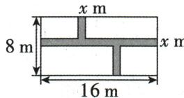

<!-- question-source:start -->
8[2024 广东佛山禅城区校级质检]如图是一块长 16 m, 宽 8 m 的矩形菜地, 现要在中间铺设相同宽度的石子路, 余下的部分用于种植, 且种植面积为 $105 \, m^{2}$ . 设石子路的宽度为 x m, 则下面所列方程正确的是 ( )

A. $(16 - x)(8 - x) + x^{2} = 105$ B. $(16 - x)(8 - x) = 105$ C. $(16 - 2x)(8 - x) + x^{2} = 105$ D. $(16 - 2x)(8 - x) = 105$

<!-- question-source:end -->

![[Q00106432A1]]
