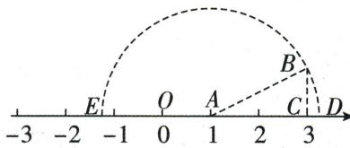

<!-- question-source:start -->
5[2024 浙江杭州拱墅区期中, 中]如图, 点 O 为数轴原点, 点 A 与点 C 表示的数分别为 1 和 3, 宜宸在数轴上以 C 为直角顶点作 Rt $\triangle ABC$ , BC=1, 再以 A 为圆心, AB 长为半径画圆, 交数轴于 D, E 两点. 莲莲说: “若 D, E 分别表示 m 和 n, 我发现 x=m 是一元二次方程 $x^{2}+bx-4=0$ 的一个根.” 球琮说: “x=n 一定不是此方程的根.”

(1) 写出 $m$ 与 $n$ 表示的数.

(2)求出 b 的值.

(3)你认为琮琮说得对吗？为什么？

<!-- question-source:end -->

![[Q00106439A1]]
