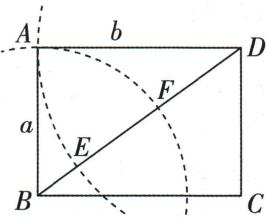

<!-- question-source:start -->
3 新考法[2025 四川达州质检, 中]如图, 在矩形ABCD中, 以点D为圆心, AD为半径作弧与BD交于点E, 以点B为圆心, AB为半径作弧与BD交于点F. 设AB=a, AD=b, 则()

A. 线段 $DF$ 的长是方程 $x^{2} + 2ax = b^{2}$ 的一个解
B. 线段 $DF$ 的长是方程 $x^{2} - 2ax = b^{2}$ 的一个解
C. 线段 $BE$ 的长是方程 $x^{2} + bx = a^{2}$ 的一个解
D. 线段 $BE$ 的长是方程 $x^{2} - bx = a^{2}$ 的一个解
<!-- question-source:end -->

![[Q00106480A1]]
