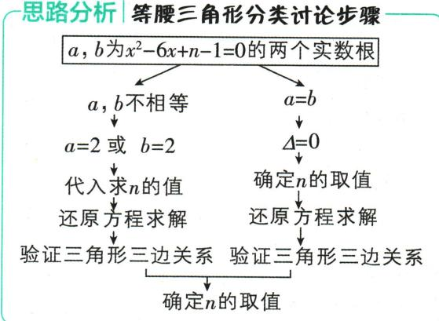

> [!success]- 必刷题
>
> > [!success] **【答案】** B
>
> > [!note]- **【解析】**
> > 关于 x 的一元二次方程 $ax^{2} + bx - 1 = 0$ 的根的判别式为 $\Delta = b^{2} + 4a$ .
> >
> > 甲 当 $a, b$ 同号时，若两数均为负数，则不能确保 $b^2 + 4a$ 为非负数，不符合条件
> > 乙 当 $a - b - 1 = 0$ 时，得到 $a = b + 1$ ，所以 $b^2 + 4a = b^2 + 4(b + 1) = (b + 2)^2 \geqslant 0$ ，所以方程总有实数根，符合条件
> > 丙 当 $a + b - 1 = 0$ 时，得到 $a = 1 - b$ ，所以 $b^2 + 4a = b^2 + 4(1 - b) = (b - 2)^2 \geqslant 0$ ，所以方程总有实数根，符合条件
> >
> > 综上所述,甲的建议不符合条件,乙和丙的建议符合条件,故选 B.
> >
> > 
> >
> > 【解析】∵三角形是等腰三角形，∴有a=2或b=2，以及a=b两种情况.①当a=2或b=2时，∵a,b是关于x的一元二次方程 $x^{2}-6x+n-1=0$ 的两个实数根，∴把x=2代入 $x^{2}-6x+n-1=0$ ，得 $2^{2}-6\times2+n-1=0$ ，解得n=9，∴原方程为 $x^{2}-6x+8=0$ ，解得 $x_{1}=2, x_{2}=4$ 。而长为 2, 2, 4 的线段不能组成三角形，故不符合题意。
> > - **②**：当 a=b 时，方程 $x^{2}-6x+n-1=0$ 有两个相等的实数根，∴ $\Delta=(-6)^{2}-4(n-1)=0$ ，解得 n=10，∴ 原方程为 $x^{2}-6x+9=0$ ，解得 $x_{1}=x_{2}=3$ 。长为 2, 3, 3 的线段能组成三角形，符合题意。综上，n 的值为 10。
