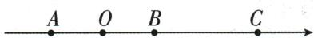

<!-- question-source:start -->
7[2025 浙江杭州期中](1)关于 x 的方程 $x(x-1)=3(x-1)$ ，下列解法完全正确的是 \_\_\_\_。（填“甲”“乙”“丙”或“丁”）

<table><tr><td>甲</td><td>乙</td></tr><tr><td>两边同时除以(x-1),得x=3</td><td>移项得 $x(x-1)+3(x-1)=0$ , $\therefore (x-1)(x+3)=0$ , $\therefore x-1=0$ 或 $x+3=0$ , $\therefore x_1=1,x_2=-3$ </td></tr><tr><td>丙</td><td>丁</td></tr><tr><td>整理得 $x^2-4x=-3$ , $\because a=1,b=-4,c=-3$ , $\therefore \Delta=b^2-4ac=28$ , $\therefore x=\frac{4\pm\sqrt{28}}{2}=2\pm\sqrt{7}$ , $\therefore x_1=2+\sqrt{7},x_2=2-\sqrt{7}$ </td><td>整理得 $x^2-4x=-3$ ,配方得 $x^2-4x+4=1$ , $\therefore (x-2)^2=1$ , $\therefore x-2=\pm 1$ , $\therefore x_1=1,x_2=3$ </td></tr></table>

(2)选择合适的方法解方程: $8x^{2}-10x+3=0$ .

<!-- question-source:end -->

![[Q00106491A1]]
