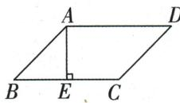

<!-- question-source:start -->
1[2025 山西大同质检, 中]如图, 在 $\square ABCD$ 中,

$\angle B=45^{\circ},AE$ 是 BC 的垂直平分线,且 AE 的长是一元二次方程 $2x^{2}-4x=5(2-x)$

的一个根,则□ABCD的周长为 ( )
A.6 B.12
C. $4+2\sqrt{2}$ D. $8+4\sqrt{2}$
<!-- question-source:end -->

![[Q00106492A1]]
