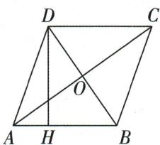

<!-- question-source:start -->
1[2024 广东深圳调研, 中]如图, 四边形 ABCD 是边长为 5 的菱形, 对角线 AC, BD 的长度分别是一元二次方程 $x^{2} + mx + 24 = 0$ 的两实数根, DH 是 AB 边上的高, 则 DH 的长为 ( )

A. 1.2 B. 2.4 C. 3.6 D. 4.8
<!-- question-source:end -->

![[Q00106507A1]]
