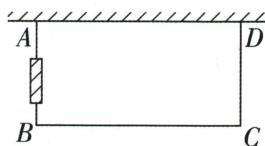

<!-- question-source:start -->
7[2024 内蒙古通辽中考]如图, 小程的爸爸用一段 10 m 长的铁丝网围成一个一边靠墙(墙长 5.5 m) 的矩形鸭舍, 其面积为 $15 \, m^{2}$ , 在鸭舍侧面中间位置留一个 1 m 宽的门(由其他材料制成), 则 BC 长为 ( )

A. $5\mathrm{m}$ 或 $6\mathrm{m}$ B. $2.5\mathrm{m}$ 或 $3\mathrm{m}$ C. $5\mathrm{m}$ D. $3\mathrm{m}$
<!-- question-source:end -->

![[Q00106537A1]]
