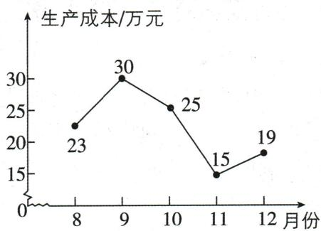

<!-- question-source:start -->
4 如图是某公司去年 8\~12 月份生产成本统计图, 设 9\~11 月份平均每个月生产成本的下降率都为 x, 根据图中信息, 得到 x 所满足的方程是 ( )

A. $30(1 - 2x) = 15$ B. $30\times 2(1 - x) = 15$ C. $30(1 - x)^{2} = 15$ D. $30 - 30(1 - 2x) = 15$
<!-- question-source:end -->

![[Q00106542A1]]
