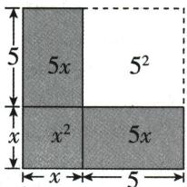
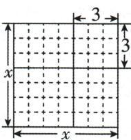
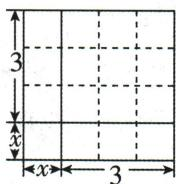

<!-- question-source:start -->
16[2025 北京海淀区期末]阅读下面的材料.
一元二次方程及其解法最早出现在公元前两千年左右的古巴比伦人的《泥板文书》中.到了中世纪,阿拉伯数学家阿尔·花拉子米在他的代表作《代数学》中记载了求一元二次方程正数解的几何解法.
以 $x^{2}+10x=39$ 为例,花拉子米的几何解法步骤如下:
①如图(1),在边长为 x 的正方形的两个相邻边上作边长分别为 x 和 5 的矩形,再补上一个边长为 5 的小正方形,最终把图形补成一个大正方形;
②一方面大正方形的面积为 $(x+\_\_\_\_)^{2}$ , 另一方面大正方形的面积又等于图中各部分面积之和, 因为 $x^{2}+10x=39$ , 可得方程 $(x+\_\_\_\_)^{2}=39+\_\_\_$ , 则方程的正数解是 x=\_\_\_\_.

图(1)

①

图(2)
②

根据上述材料,解答下列问题.
(1)补全花拉子米的解法步骤②;
(2)根据花拉子米的解法,在图(2)的两个构图①②中,能够得到方程 $x^{2}-6x=7$ 的正数解的正确构图是\_\_\_\_(填序号).
<!-- question-source:end -->

![[Q00107131A1]]
