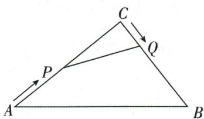

<!-- question-source:start -->
17. [中] 如图, 在 $\mathrm{Rt} \triangle ABC$ 中, $\angle C = 90^\circ, AC = 20\mathrm{cm}, BC = 15\mathrm{cm}.$ 点 $P$ 从点 $A$ 出发沿边 $AC$ 向点 $C$ 以 $4\mathrm{cm/s}$ 的速度移动, 点 $Q$ 从点 $C$ 出发沿边 $CB$ 向点 $B$ 以 $2\mathrm{cm/s}$ 的速度移动, 若 $P, Q$ 同时出发, 问几秒后 $\mathrm{Rt} \triangle CPQ$ 的面积 $S = \frac{4}{25} S_{\triangle ABC}$?

<!-- question-source:end -->

![[Q00107132A1]]
