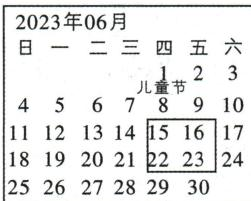

<!-- question-source:start -->
7[2024 江西九江质检]下图是某一个月的日历表,在表上可以用一个方框圈出四个数(如图所示).请用方程知识解答下列问题:

(1) 若在圈出的四个数中, 最小数与最大数的乘积为 84, 求最小数.

(2)在圈出的四个数中,最小数与最大数的乘积能为33吗?请说明理由.

扶鸭起来
鸭还能学
<!-- question-source:end -->

![[Q00106521A1]]
