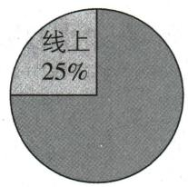
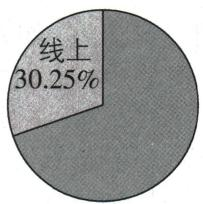

<!-- question-source:start -->
1 新考法[2025 山西吕梁质检]为开拓市场,某蛋糕生产厂家采用线下和线上两种销售方式销售蛋糕,厂长统计了今年6月份和8月份线上销售量占总销售量的百分比,并绘制成如图所示的两幅扇形统计图,由统计图可知,线上销售量占比的月平均增长率为\_\_\_\_.

6月份

8月份
<!-- question-source:end -->

![[Q00106522A1]]
